<div align="center">

# contribution-gallery

**A living canvas for your GitHub profile.**

<picture>
  <source media="(prefers-color-scheme: dark)" srcset="docs/ambient-dark.svg" />
  <source media="(prefers-color-scheme: light)" srcset="docs/ambient.svg" />
  
</picture>

Ten ambient scenes and four profile cards, all drawn in contribution cells.

[](LICENSE)

</div>

## Ambient gallery

Ten scenes play across your contribution graph, one every 15 seconds on a single seamless 150-second loop — no reset, no pause. Some are ambient loops; others are little stories that play out from start to finish inside their window.

| Scene | Description |
|-------|-------------|
| 🌈 Plasma | Demoscene palette cycling — bands of color roll along a sum-of-sines field |
| ✨ Constellation | Your busiest days become stars, joined one by one into a star chart, then a meteor or two streaks past |
| 🌊 Tide | One long swell rolls across the year, deep teal at the floor and pale foam at each crest |
| 🌌 Aurora | Curtains of light drift and fold over the year, with rays shimmering through them |
| 🧭 Pathfinder | A breadth-first search floods a maze from the first day to the latest, then traces the route |
| 🦠 Life | Conway's Game of Life, seeded by the days you showed up |
| 📊 Sort | Weeks ranked by activity become bars, sorted in parallel passes into a staircase |
| 🏓 Pong | The year plays itself at Pong — spin off the paddles, a pixel scoreboard, the odd missed return |
| 🎆 Fireworks | Your biggest weeks are launched into the night — rockets climb, pixel sparks burst outward and fall, and a three-shell finale closes the show |
| 💧 Ripples | Rain falls on the days you showed up, and every drop sends rings spreading across the year |

Every scene draws from one spectrum — mint, sky, indigo, violet, pink and a single warm amber — tuned separately for light and dark cards, and a blurred copy of the scene layer gives every lit cell a soft bloom at no extra file size. The real graph always stays underneath: each scene dims it with its own veil rather than replacing it, so your year remains readable through every animation. The card is labelled like a piece on a gallery wall: its heading is the scene now playing, set in Fraunces Italic above a one-line caption, and a soft glow behind it takes that scene's hue. The date range and your active days sit to the right. The graph reveals itself column by column on load, scenes crossfade with eased envelopes while a band of light in the incoming scene's hue sweeps across the year, and the footer carries the graph's own Less–More legend beside a row of ten cells that fill, one per scene, in each scene's hue.

Story scenes (Pathfinder, Sort, Pong, Constellation, Life, Fireworks) are scripted in SMIL on the shared cycle and rest at their first frame outside their window, so every crossfade starts cleanly. Continuous scenes are compact CSS keyframe loops where each cell only carries a phase offset, or a few vector shapes (Aurora's curtains, Ripples' rings) seen through the cell lattice as a mask. Scenes off stage stop painting, so only the one or two on screen cost anything to draw. The scene order is shuffled on every render, and so are the details — the maze, the rally, the star picks, the shells, the plasma field — while the file stays around 370–420 KB.

Enable it with `?mode=ambient` in the action outputs:

```yaml
outputs: |
  dist/ambient.svg?mode=ambient
  dist/ambient-dark.svg?palette=dark&mode=ambient
```

Or via CLI: `npx tsx src/cli.ts --user <name> --mode ambient [--dark]`

### 🔀 Per-refresh shuffle (serverless endpoint)

A committed SVG is static, so its scene order only changes when it is regenerated. For a freshly shuffled order on **every page load**, deploy the included Vercel function and point your README at it:

[](https://vercel.com/new/clone?repository-url=https%3A%2F%2Fgithub.com%2F42si%2Fcontribution-gallery)

- `GET /api/ambient` — light theme
- `GET /api/ambient?theme=dark` — dark theme

The endpoint renders the SVG with a random seed per request and sends `Cache-Control: no-store`, so GitHub's camo proxy re-fetches it on every view. Contribution data comes from [docs/grid.json](docs/grid.json), regenerated daily by CI — no GitHub token is needed at request time (override the data source with the `GRID_URL` env var).

```html
<picture>
  <source media="(prefers-color-scheme: dark)" srcset="https://<your-project>.vercel.app/api/ambient?theme=dark" />
  <source media="(prefers-color-scheme: light)" srcset="https://<your-project>.vercel.app/api/ambient" />
  .vercel.app/api/ambient?theme=dark" />
</picture>
```

### 📊 Profile cards (stats, langs, streak, trophy)

Four endpoints share one idea with the gallery: the picture is drawn in contribution cells — the same rounded square, on the same seven-row lattice, as the graph — and the words around it are set quietly, like a wall label. Each title is in Fraunces Italic; everything else stays out of the way.

| Endpoint | Card |
|----------|------|
| `/api/stats` | **Activity** — the commit total written into a strip of graph, cell by cell, above stars, pull requests, issues and followers |
| `/api/langs` | **Languages** — a contribution graph painted by language, where each language's area is its share of code and each takes the light in turn |
| `/api/streak` | **Streak** — the current streak burning in cells beside a pixel flame, with the longest streak and all-time contributions |
| `/api/trophy` | **Milestones** — seven pixel cups cast in the metal of their rank, each naming the next rank within reach |

Use `?theme=dark` for the dark palette; the default API palette remains light for existing embeds. The ambient, streak, and trophy cards are 753px wide. The stats and languages cards are 375 × 256px; embed each at `width="369"` to fit them side by side with a small gap, and let them wrap on narrow screens. All images have self-contained SVG/CSS animations, accessible descriptions, and reduced-motion fallbacks. The ten ambient scenes play in a freshly shuffled order on every render.

Numbers come from [docs/stats.json](docs/stats.json), refreshed by CI every six hours. Language percentages describe the indexed language bytes in that snapshot; the mosaic's 238 cells are shared out in proportion, and languages past the ninth are folded into one entry. No GitHub token is needed at request time.

Titles are set in **Fraunces Italic**. Each SVG embeds a subset holding only the letters of its own titles — 3–4 KB per card, 11 KB for the ambient card's ten scene names — so they render the same everywhere without a font request.

Profile numbers and language percentages use **Inter** by default. Choose `font=outfit` for rounder numerals, `font=space` for Space Grotesk, or `font=mono` for the system monospace; for example, `/api/stats?theme=dark&font=inter`. The three bundled typefaces embed only their numeric glyphs. Switch between all four styles in `npm run preview`. Font sources and licenses are in [src/renderer/fonts](src/renderer/fonts).

## Quick Start

```yaml
# .github/workflows/contribution-gallery.yml
name: Generate Contribution Gallery

on:
  schedule:
    - cron: "0 0 * * *"
  workflow_dispatch:

permissions:
  contents: write

jobs:
  generate:
    runs-on: ubuntu-latest
    steps:
      - uses: 42si/contribution-gallery@v1
        with:
          github_user_name: ${{ github.repository_owner }}
          outputs: |
            dist/ambient.svg?mode=ambient
            dist/ambient-dark.svg?palette=dark&mode=ambient

      - uses: crazy-max/ghaction-github-pages@v4
        with:
          target_branch: output
          build_dir: dist
        env:
          GITHUB_TOKEN: ${{ secrets.GITHUB_TOKEN }}
```

Then add to your profile README:

```html
<picture>
  <source media="(prefers-color-scheme: dark)" srcset="https://raw.githubusercontent.com/<user>/<user>/output/ambient-dark.svg" />
  <source media="(prefers-color-scheme: light)" srcset="https://raw.githubusercontent.com/<user>/<user>/output/ambient.svg" />
  /<user>/output/ambient-dark.svg" />
</picture>
```

<details>
<summary>Optional territory battle and customization</summary>

### Territory battle

A GitHub Action that generates an animated SVG of two snakes battling for territory on your GitHub contribution graph — like a Splatoon ink battle.

Unlike the classic [Platane/snk](https://github.com/Platane/snk) (single snake eating cells), this project features:

- **Two competing snakes** — starting from opposite corners of the grid
- **Territory painting** — each snake claims cells in Hot Pink or Cyan
- **Competitive AI** — 9 heuristic factors + stagnation-aware ε-greedy exploration
- **Score display** — live territory percentage bar
- **Dark mode support** — separate palettes for light/dark themes

### How it works

Each snake evaluates moves using a **multi-factor scoring system** that balances local efficiency with global exploration:

| Factor | Weight | Purpose |
|--------|--------|---------|
| Distance-decayed BFS | variable | Prioritize nearby unpainted cells |
| Frontier bonus | +15 | Reward painting fresh ground |
| Global compass | +10 | Head toward unexplored regions |
| Opponent avoidance | +10/−8 | Separate snakes for coverage |
| Escape route check | −5/−20 | Avoid dead-ends |
| Long-range navigation | +30/−10 | March toward nearest target when stuck |
| Loop detection | force random | Break positional cycles |
| Stagnation ε-greedy | 0.5%→15% | Increasing randomness when stuck |

This achieves **100% grid coverage** with natural variation in territory split.

**[→ Full algorithm documentation](docs/ALGORITHM.md)**

### Customization

| Option | Default | Description |
|--------|---------|-------------|
| `color_snake_1` | `#E8006A` | Hot Pink — Snake 1 body |
| `color_snake_2` | `#008CC8` | Cyan — Snake 2 body |
| `color_trail_1` | `#FF85AA` | Light Pink — Snake 1 trail |
| `color_trail_2` | `#5DD4FF` | Light Cyan — Snake 2 trail |
| `speed` | `1` | Animation speed multiplier |
| `strategy` | `aggressive` | AI strategy: `aggressive`, `balanced`, `random` |

</details>

## Architecture

```
src/
├── fetcher/          # GitHub API
│   ├── index.ts      # Contribution calendar → grid
│   └── stats.ts      # All-time totals & streaks (→ docs/stats.json)
├── solver/           # Snake AI — multi-factor heuristic scoring
│   └── index.ts      # chooseDirection(), BFS, loop detection
├── renderer/         # SVG animation generator
│   ├── grid.ts       # Contribution grid rendering
│   ├── animation.ts  # Keyframe animation engine (splatoon battle)
│   ├── ambient.ts    # Ambient mode — assembles the ten scenes on one loop
│   ├── scenes/       # One file per scene, plus the shared timeline kit
│   ├── theme.ts      # Shared palette, typography and accessible SVG framing
│   ├── cells.ts      # Drawing in cells — 5 × 7 numerals, lattices, write-on
│   ├── titles.ts     # Every string set in the display face
│   ├── fonts/        # Embedded font subsets and their licenses
│   ├── stats.ts      # Activity card — the commit total written in cells
│   ├── langs.ts      # Languages card — a mosaic of cells by share of code
│   ├── streak.ts     # Streak card — the streak burning in cells, with a flame
│   └── trophy.ts     # Milestones card — seven pixel cups by rank
├── game/             # Game loop & territory logic
│   ├── engine.ts     # Turn-based simulation + stagnation tracking
│   ├── snake.ts      # Snake state & movement
│   └── territory.ts  # Score calculation
├── cli.ts            # Local dev entry point
└── cli-stats.ts      # CLI: emit docs/stats.json (run daily by CI)
api/
├── ambient.ts        # Vercel function — per-request random ambient SVG
├── stats.ts          # Vercel function — stats card SVG
├── langs.ts          # Vercel function — top languages card SVG
├── streak.ts         # Vercel function — streak card SVG
└── trophy.ts         # Vercel function — trophy card SVG
```

## Development

```bash
npm install
npm run preview    # Browser preview at http://127.0.0.1:4173 (dark by default)
npm run render:examples # Regenerate ambient SVGs from docs/grid.json
npm run type-check # Check TypeScript
npm run build      # Build the GitHub Action
npm run test       # Run tests
```

## License

Code: MIT. Bundled fonts (Fraunces for titles; Inter, Outfit and Space Grotesk for numerals): SIL Open Font License 1.1; see [font licenses](src/renderer/fonts).
